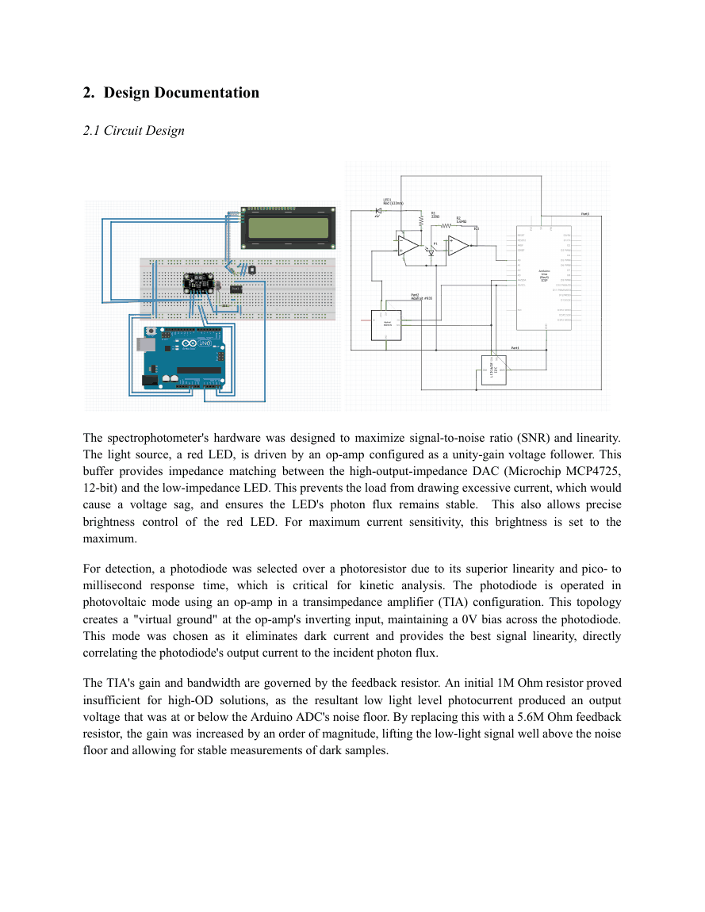
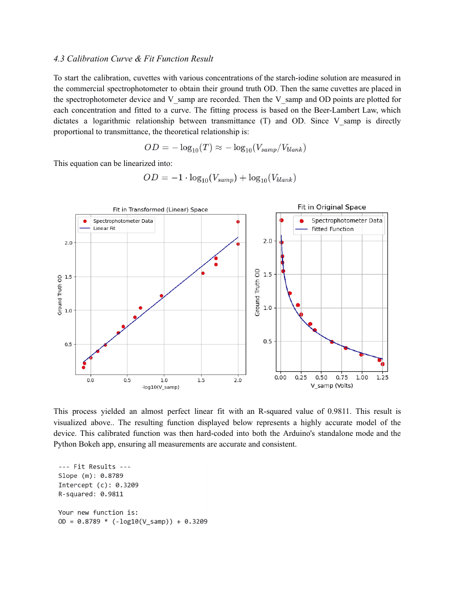
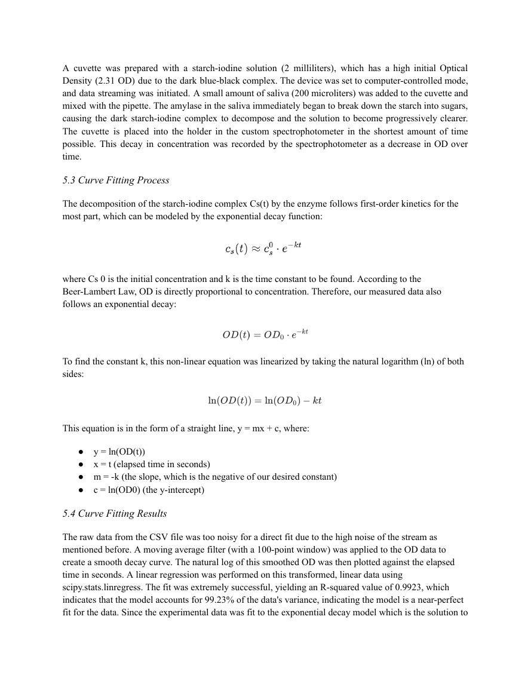

# Spectrophotometer

A Caltech **BE/EE/MedE 189a** project, as identified in the supplied write-up.

An Arduino instrument measuring red-light transmission through a cuvette, with standalone LCD readings and host-side optical-density streaming. The [write-up](Spectrophotometer%20Write-Up.pdf) by Gabo Zhang supplies the optics, circuit and experiment context.

## Optical and analog path

A red LED and opposing photodiode are aligned across a cuvette in a covered light-excluding holder. An MCP4725 12-bit DAC drives an op-amp voltage follower for LED brightness control. The photodiode is read with a photovoltaic transimpedance amplifier; the report describes changing its feedback resistor from 1 MΩ to 5.6 MΩ for low-light sensitivity. A later proposed-improvement paragraph mentions 10 MΩ instead, so the prose is not a consistent as-built component list. No precise LED wavelength is established by the supplied text.

Beer–Lambert absorbance is `A = -log10(I / I0)` and, for fixed path length and extinction coefficient, proportional to concentration. Here the implemented conversion is an empirical fit against commercial-instrument OD standards, using voltage as a proxy for transmitted intensity rather than explicitly dividing by a blank in the final formula.

## Firmware: `Spectrophotometer_whold.ino`

Setup starts 115200-baud serial, a 16×2 I²C LCD at 0x27 and MCP4725 at 0x62, with brightness code 4095. A0 reads the detector; D2 calibration and D3 hold buttons use internal pull-ups. The loop dispatches between standalone and streaming modes, with serial `S` entering streaming and `X` returning to standalone.

Standalone calibration averages 20 readings spaced by 10 ms and stores `V_blank`, using a 5 V / 1023 ADC conversion. Measurement requires a positive blank, averages the same way, clamps sample voltage at the blank and floors nonpositive voltage at 0.00001 V. It computes `OD = 0.8789 × (-log10(V_sample)) + 0.3209`. The blank gates/clamps acquisition; it is **not** a denominator in that calibration formula. An edge-detected D3 press toggles a held OD/voltage display with a 50 ms blocking debounce.

Streaming sends a raw integer ADC line every 50 ms (plus execution overhead), bypassing averaging and on-board OD calculations. The sketch's `rawValue = 0.01` assignment is to an integer and therefore does not create a positive voltage floor. The Python logarithm floor handles zero separately.

## Notebook map and calibration versions

* `Spectrophotometer App.ipynb`: calibration fit plus the Bokeh streaming application.
* The fit cells regress OD against `-log10(V_sample)` for 15 embedded standards, retaining positive voltages. Saved output gives slope 0.8789, intercept 0.3209 and R² = 0.9811, matching the Arduino formula.
* The live app instead uses `CALIB_SLOPE = 1.0022` and `CALIB_INTERCEPT = 0.3013`. Thus it does **not** reproduce the firmware/fit-cell calibration despite the report describing a common calibration. It converts 10-bit ADC codes with a 5 V reference and floors voltage at 1e-9 before the log.
* Bokeh provides connect/disconnect (`S`/`X`), a host polling interval (default 50 ms, minimum 20 ms), timestamp bookmarks and CSV export for both full stream and bookmarks. Changing the host callback interval does not change the firmware's 50 ms delay. The included update function does not smooth the OD stream, despite smoothing language in the report.
* `Drift_Noise_Validation.ipynb` belongs here: it analyzes `od_stream_data_20251112_115938.csv`, takes its first 60 s and estimates mean bias, standard deviation and linear time drift.
* `Iodine_Fit.ipynb` belongs here: it reads `od_stream_data_20251111_234938.csv`, applies a 100-sample moving mean, excludes nonpositive OD and regresses `ln(OD)` against elapsed seconds for `OD(t) = OD0 exp(-k t)`. Its `k` is a rate constant in s⁻¹, not a time in seconds.

## Reported experiments

Saved drift output: reference OD 0.9800, mean 1.0157, bias +0.0357 OD, standard deviation 0.076159 OD and slope +0.00013165 OD/s. Its projected ten-minute drift (+0.0790 OD) is an extrapolation, not a ten-minute measurement. The notebook's ±2σ label should not be read as an independently established confidence interval for the mean.

The report describes adding 200 µL saliva to 2 mL starch–iodine solution. Saved `Iodine_Fit.ipynb` output gives k = 0.000305 s⁻¹, fitted initial OD 1.4694, R² = 0.992333 and experiment duration 108.89 min. These are results in the supplied artifacts, not a rerun or proof of a universal reaction model.

## Running and limits

The sketch implies Wire, Adafruit MCP4725 and LiquidCrystal_I2C Arduino libraries; place it in a matching sketch folder for the IDE. The notebooks require Jupyter, NumPy, pandas, Matplotlib, SciPy, PySerial and Bokeh, with notebook embedding configured for `localhost:8888`. No versions are pinned. Raw CSVs, hardware and mechanical CAD were not provided. Calibration coefficients, reference voltage and serial port need review for a new setup. Firmware was not compiled and notebooks were not executed here. HTML exports were omitted in favor of their notebooks.
